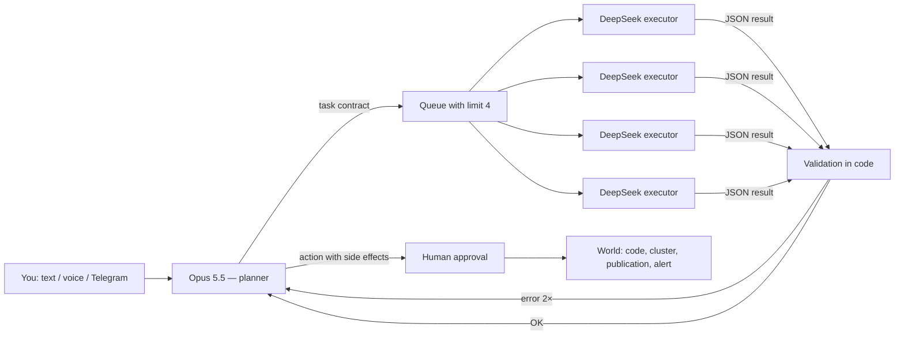

# Architecture: Opus plans, local agents execute

**As of 11 October 2026.** How to assemble the harnesses from [01-PROFILES.md](01-PROFILES.md) and the building blocks
from [02-BUILDING-BLOCKS.md](02-BUILDING-BLOCKS.md) into applications on my hardware: 4× AMD Radeon AI PRO R9700, llama-swap,
DeepSeek-V4-Flash as the local executor, Claude Opus 5.5 as the planner. The hardware numbers are measured
(sources below), the cloud prices were checked on the pricing page on 11 October 2026. Everything else is a design — **unmeasured**
until you build it and measure it.

---

## Table of contents

1. [Resources: what you really have](#1-resources-what-you-really-have)
2. [Pattern: planner and executors](#2-pattern-planner-and-executors)
3. [What is proven and what is not](#3-what-is-proven-and-what-is-not)
4. [Five use cases — concrete layouts](#4-five-use-cases--concrete-layouts)
5. [Costs: is local cheaper?](#5-costs-is-local-cheaper)
6. [Path: what to take off the shelf, what to build yourself](#6-path-what-to-take-off-the-shelf-what-to-build-yourself)

---

## 1. Resources: what you really have

| | DeepSeek-V4-Flash-0731 (UD-IQ3_XXS) | gpt-oss-20b |
|---|---|---|
| Architecture | MoE, 284B parameters, 13B active, context up to 1M | MoE, MXFP4 |
| Weight size | 104.2 GB across 4 cards | ~13 GB |
| Slots in llama-swap | `--parallel 4`, 512k context = **4 × 131k** | — |
| Generation, 1 agent | **22.6 tok/s** | 141 tok/s |
| Generation, 4 agents at once | **13.6 tok/s per agent** (54.3 total) | 81 tok/s per agent (325 total) |
| Prompt reading (4k tokens per agent) | **1,186 tok/s** for 1 agent; **1,694 tok/s total** for 4 agents | — |
| Optimum | **3 agents at once**: each keeps 75% of its solo speed, the machine does 2.2× more work | — |
| Quality — hard task set (PL / EN) | **92 / 93** (agents 97, research 94, long documents 86 / 88) | 47 / 52 |

Sources: [PARALLEL.md](https://github.com/michal-koniu/local-llm-bench-results/blob/main/PARALLEL.md) and
[RESULTS.md](https://github.com/michal-koniu/local-llm-bench-results/blob/main/RESULTS.md)
in the results repository; model: [DeepSeek-V4-Flash model card](https://huggingface.co/deepseek-ai/DeepSeek-V4-Flash).

Three conclusions that drive the whole architecture:

1. **VRAM is full.** DeepSeek leaves about 1.4 GB free on each card. A speech, vision or image-generation model
   will not fit alongside it — it has to run on the CPU, get a card after a model swap in llama-swap (which takes a while), or go to
   the cloud. This is the most important constraint for U4 and U5.
2. **Context costs time, not just memory — and reading is shared.** A single agent reads a prompt at
   about 1,200 tok/s, so a 50k-token context without cache is about 40 seconds before it writes its first word.
   When several start at once, they split that speed between them: the total only rises to about 1,700 tok/s, so
   4 agents, each starting with 16k tokens of context, wait **44 s** for the first token. Thanks to slots,
   each agent has its own prompt cache and in subsequent turns reads only the new part of the conversation — provided the prefix is stable
   (pitfall H4 in [01-PROFILES.md](01-PROFILES.md#seven-pitfalls-common-to-all)). This matters more
   than the choice of harness.
3. **Four slots is a hard limit, three is the optimum.** Plan for 3 executors at once and one spare slot (for the planner
   in fully local mode or for an urgent task). A fifth request waits in the queue. Set the limit in one place
   together with the queue — in the gateway (Bifrost), in the framework (`ConcurrencyLimiter` in Pydantic AI) or in the task queue
   (DBOS, Prefect).

You also have a `gpt-oss-20b-cpu` variant in llama-swap, which runs without the cards. A llama-swap group in which models do not evict
each other lets you keep DeepSeek on the GPU and small models on the CPU at the same time — an entry point for fast, simple
turns (e.g. voice). I did not measure the generation speed of the CPU variant.

---

## 2. Pattern: planner and executors



Eight principles, collected from the best ideas of the harnesses in the ranking:

1. **A task contract, not a conversation.** The planner sends the goal, inputs, allowed tools, result schema, budget
   (tokens and time) and a "done" criterion. The executor gets a fresh context (OpenCode, Deep Agents, Hermes).
2. **Executors read, the planner writes.** Local executors have small read-only toolsets; everything that
   changes the world (writing files, `kubectl apply`, publishing, spending money) goes through the planner and a human.
3. **Always a structured result.** JSON validated in code + one repair turn (Hermes `output_schema`, Pydantic AI).
4. **Escalation after two failures.** When an executor fails validation twice, the task goes back to Opus.
5. **One concurrency limit** (principle 3 from section 1).
6. **A stable prompt prefix** — time and variable data in the user message, not in the system prompt (Moltis).
7. **Thinking only where needed.** For simple executors, turn off DeepSeek's thinking mode or make sure
   the harness sends back `reasoning_content` (pitfall H2).
8. **Measure on your own tasks.** Success rate and Opus tokens per completed task, not per request.

### Fully local mode

When data cannot leave home (e.g. work logs in U1) or you do not want to pay for the cloud, the same pattern works without
Opus — DeepSeek stays as the planner. A layout for 4 slots:

| Slot | Role | Settings |
|---|---|---|
| 1 | planner: plan, task contracts, synthesis of results | DeepSeek with thinking on, the full task context |
| 2–4 | executors (3 = measured optimum) | DeepSeek, thinking off for simple tasks, small read-only toolsets |
| CPU | quick classifications, routing, short voice replies | `gpt-oss-20b-cpu` |

What is missing without Opus and how to make up for it: the planner is no smarter than the executors, so **tighten the contracts**
(narrower tasks, explicit "done" criteria, checklists), **move more checking into code** (validation,
tests, comparison against rules) and **escalate to a human instead of to Opus**. On the hard task set DeepSeek scored
97 on agentic tasks and 94 on research, so this mode is realistic — but it does worse on long documents
(86 / 88) and repeatability (83), so add a second pass or a human there. Every harness in the ranking lets you
set the same local model for the planner and the executors.

**A local executor as a privacy filter.** An executor can summarize logs and strip secrets from them before anything
goes to the cloud. With work data this is often a precondition for using a cloud planner at all — before you send anything
to Opus, check your company's policies.

---

## 3. What is proven and what is not

### Proven (measured, with caveats)

| Result | Numbers | Source |
|---|---|---|
| A strong planner + a cheap executor works for well-specified subtasks | Aider (2024): o1-preview + DeepSeek as editor 80.5%, Sonnet + DeepSeek 78.9% | [Aider: architect/editor](https://aider.chat/2024/09/26/architect.html) |
| The cloud splits the task, a local model processes the long context | Minions: cloud cost 5.7× lower at 97.9% of the cloud-only quality (QA on long documents) | [arXiv 2502.15964](https://arxiv.org/abs/2502.15964) |
| Escalating only at decision points pays off | Anthropic advisor tool: Sonnet + Opus advisor +2.7 pp at 11.9% lower cost (vendor measurement, Claude models only) | [The advisor strategy](https://claude.com/blog/the-advisor-strategy) |
| Learned step-by-step routing between device and cloud | Hera: 92.5% of the cloud-only success rate while using the cloud in 46.3% of steps | [arXiv 2605.24598](https://arxiv.org/abs/2605.24598) |
| Local models alone are clearly weaker | OpenJarvis: swapping Opus 4.6 for Qwen3.5-9B cost 25–39 pp | [arXiv 2605.17172](https://arxiv.org/abs/2605.17172) |
| The plumbing works | llama-server and llama-swap speak `/v1/messages` (the Anthropic API); llama.cpp parses DeepSeek tool calls (DSML) and since September 2026 uses the prompt cache in agent loops | [llama.cpp #29008](https://github.com/ggml-org/llama.cpp/pull/29008), [llama-swap](https://github.com/mostlygeek/llama-swap) |

### Unproven or untrue

- **"Claude Code / Agent SDK subagents on local models" — this is not a supported feature.** The request for choosing a
  provider per agent ([#38698](https://github.com/anthropics/claude-code/issues/38698)) is open, and workarounds via
  gateways recognize the model by name or headers and require an API key, not a subscription. **The reverse pattern works:**
  Claude stays the orchestrator, and the local agents are **tools** for it — an MCP server
  (e.g. [mcp-llama-swap](https://github.com/oussama-kh/mcp-llama-swap),
  [PAL](https://github.com/BeehiveInnovations/pal-mcp-server)) or a custom tool in the Agent SDK.
- **The advisor tool will not turn DeepSeek into an executor** — it requires both the executor and the advisor to be Claude models.
  You orchestrate a hybrid with a local model yourself (or with a harness from the ranking).
- **Automatic leader → worker handoff.** Goose had such a mode in 2025 and removed it; what survived is explicit
  delegation to named executors with their own model ([Goose: multi-model](https://goose-docs.ai/docs/guides/multi-model/)).
- **"60–70% of agent calls could go to small models"** — this is an estimate from an NVIDIA position paper, not a measurement.
- **"Local is cheaper"** — see [section 5](#5-costs-is-local-cheaper).
- **There is no public measurement of exactly your pair** (Opus 5.5 + 3-bit DeepSeek-V4-Flash) on DevOps tasks,
  market opportunities or voice. Build your own evaluation (section 6, step 0).

---

## 4. Five use cases — concrete layouts

### U1 — DevOps: development and diagnosis

**Don't build — take a ready-made harness.** Simplest: **OpenCode** (or Goose) with the main agent on Opus 5.5 and subagents
on DeepSeek. The second route, if you work in Claude Code anyway: keep Claude Code as the orchestrator and add to it an
MCP server that sends tasks to local agents (section 3).

```text
alert / ticket
  → Opus: hypotheses and a plan (what to check)
  → 2–4 local subagents IN PARALLEL, read-only:
       logs (Loki), metrics (Prometheus), recent deployments (GitHub/GitLab), cluster state (K8s)
  → each returns JSON: {facts, log quotes, confidence}
  → Opus: diagnosis + a proposed fix (diff / command)
  → You approve → Opus or you apply the change
```

Building blocks: kubernetes-mcp-server (`read_only = true`), mcp-grafana (`--disable-write`), github-mcp-server (`--read-only`),
srt around the executors' shell. Permissions in OpenCode: `kubectl get|describe|logs` → allow, `apply|delete|exec` → ask.
Course: [part 7 of course 1](../course_local_models/07-SANDBOX-SECURITY-MONITORING.md) (sandbox) and
[part 10 of course 2](../course_agentic_apps/10-PRODUCTION-SANDBOX.md).

### U2 — Passive income: complex workflows

**Build your own application on a framework** — here the gain comes from fitting the workflow to your idea, and ready-made harnesses
are generic. The choice: **Pydantic AI** (typed results, the 4-slot limit, durability via Prefect / DBOS) or **LangGraph**
(graphs with checkpoints and human interrupts). Without code: **n8n** for gluing integrations together (the license allows
personal use, not reselling n8n).

```text
weekly:   Opus plans (what to research, what to create, what to measure)
daily:    local executors — research, drafts, data extraction, housekeeping
          → validation → Opus judges the quality of samples
always:   a human approves everything that publishes or spends money (ntfy / Telegram with a button)
measure:  revenue, Opus cost, time of your attention — per completed cycle
```

Building blocks: Prefect or DBOS (queue with limit 4), Cognee (project memory), microsandbox (code written by agents),
Apprise → ntfy, promptfoo in CI. Course: [part 3 of course 2](../course_agentic_apps/03-HARNESS-LONG-RUNNING-TASKS.md)
(harness for long-running tasks) and [part 13](../course_agentic_apps/13-MULTI-AGENT-FLEET.md) (agent fleet).

### U3 — Markets and opportunities: search and alerts

**A funnel: cheap filters in code first, then a local model, Opus last.** Precision comes from structure
(schemas, deduplication, thresholds in code), not from one giant prompt.

```text
systemd timers (later Prefect)
  → sources: changedetection.io (prices, availability), SearXNG + Crawl4AI / Trafilatura (listings, news),
             OpenBB / edgartools / CCXT read-only (market)
  → rules in code: price threshold, % change, novelty, deduplication     ← 90% drops out here, for free
  → local DeepSeek: extraction to JSON (price, terms, risks, source)     ← in parallel, limit 4
  → rules in code on the JSON
  → Opus only for candidates: "is this really an opportunity and why?"   ← few tokens, high quality
  → alert: ntfy / Telegram with buttons, with a link to the source and the rationale
```

For precise extraction it is worth tuning the executor's prompt with DSPy, with Opus as the teacher. Remember the terms of the data
sources (Yahoo — personal use) and that an agent's verdict is an opinion, not investment advice.
Course: [part 11 of course 2](../course_agentic_apps/11-SCHEDULING-PROACTIVITY.md) (scheduling) and
[part 12](../course_agentic_apps/12-CHANNELS-INTERFACES.md) (channels).

### U4 — voice conversation in Polish

I did not find local speech-to-speech in Polish on AMD (October 2026) — what remains is the STT → LLM → TTS cascade.
Since DeepSeek takes the VRAM, the fast voice components go on the CPU:

```text
microphone → Pipecat + Smart Turn (CPU, detects the end of an utterance in Polish)
           → STT: Parakeet-v3 (CPU) or whisper.cpp large-v3 (GPU, when a card is free)
           → the "voice" — a fast model answers right away and has a delegate(task) tool:
                gpt-oss-20b-cpu (local, private) or Haiku 5.5 / Sonnet 5.5 (cloud, fast)
           → heavy work asynchronously: DeepSeek (local) or Opus (cloud) → the result returns to the conversation
           → TTS: Piper pl_PL (CPU), then Chatterbox or VoxCPM2
```

Why not DeepSeek directly as the "voice": about 20 tokens to the first sentence at 13.6–22.6 tok/s is
0.9–1.5 s of generation alone, plus prompt processing. I **did not measure** the total latency of this setup.

The simplest start without building anything: **Hermes Agent** — voice notes on Telegram, local faster-whisper with language
`pl`, voice replies. Asynchronous, but it works from day one. Note: speech synthesis is done by default by the cloud
Edge TTS. If the voice is to stay at home, choose **Moltis** (local STT and Piper with Polish voices) or your own Pipecat.

### U5 — photos and images

The **"vision bridge"** pattern: a text-only executor gets a description of the image from a vision model (Hermes `vision_analyze`,
ZeroClaw — vision redirection, Qwen Code `visionModel`, OpenHands MultimodalRouter).

| Task | Where |
|---|---|
| screenshots, photos, charts | test DeepSeek-V4-Flash-Vision-Exp (same size + 0.93 GB); otherwise Qwen3.6-35B-A3B on a freed card |
| documents, invoices, PDF | Docling + PaddleOCR-VL-1.5 (low VRAM, also runs on CPU) |
| generation and editing | stable-diffusion.cpp behind llama-swap or ComfyUI — only Apache-2.0 models for commercial use |
| hard cases | Opus 5.5 (accepts images) — cost and privacy |

Course: [part 5 of course 1](../course_local_models/05-MULTIMODALITY.md).

---

## 5. Costs: is local cheaper?

Anthropic API prices (USD per million tokens, 11 October 2026, [pricing](https://platform.claude.com/docs/en/about-claude/pricing)):

| Model | Input | Cache read | Output |
|---|---|---|---|
| Claude Opus 5.5 | 4.00 | 0.20 | 20.00 |
| Claude Sonnet 5.5 | 2.00 | 0.10 | 10.00 |
| Claude Haiku 5.5 (prompt ≤ 100k tokens) | 0.10 | 0.01 | 0.50 |
| Claude Haiku 5.5 (prompt above 100k tokens — the whole turn 5× more expensive) | 0.50 | 0.05 | 2.50 |

Batch API: −50% on input and output (for tasks that can wait).

**The ceiling of your machine — output only:** 54.3 tok/s × 86,400 s ≈ **4.7 million output tokens per day** — with four
slots busy without a break for 24 hours. The same number of output tokens would cost in the cloud:

| Model | Cost of 4.7 million output tokens |
|---|---|
| Haiku 5.5 | approx. USD 2.35 |
| Sonnet 5.5 | approx. USD 47 |
| Opus 5.5 | approx. USD 94 |

Work out electricity yourself: measure the draw at the wall socket under full load and multiply by your rate. Your cards are limited to 250 W;
assuming 1.2 kW for the whole machine and PLN 1 per kWh, that comes to about PLN 29 per day of continuous work (an assumption, not a measurement).

**But an agent is mostly input, not output.** A realistic executor turn (assumptions, not a measurement): 30k-token
context, of which 28k from cache, 2k of new input and 500 output tokens. On this machine 4 agents do such a turn
in about 42 s (8k new tokens read in total at ~1,700 tok/s is ~5 s, then 500 tokens at
13.6 tok/s is ~37 s), which is about 8,300 turns per day at full load. The same turns in the cloud
(ignoring the small cost of writing to the cache):

| Model and context | Cost of one turn | 8,300 turns per day |
|---|---|---|
| Haiku 5.5, 30k context | ~USD 0.0007 | ~USD 6 |
| Haiku 5.5, 120k context (above the 100k threshold) | ~USD 0.008 | ~USD 68 |
| Sonnet 5.5, 30k context | ~USD 0.012 | ~USD 98 |
| Opus 5.5, 30k context | ~USD 0.024 | ~USD 196 |

The electricity at full load from the example above is ~PLN 29 per day, i.e. about USD 7 at the assumed rate of PLN 4 per dollar.

**Conclusion:** with short contexts Haiku 5.5 costs **roughly as much as the electricity** of this machine at full
load (~USD 6 versus ~USD 7 per day) — and when the machine sits idle, the cloud costs nothing, while electricity does. With
contexts above 100k tokens, or compared with Sonnet and Opus, local DeepSeek is **about 10 to 30 times
cheaper** — provided its quality is sufficient. Some local advantages are independent of prices: privacy
(data does not leave home), no limits and queues, offline work and unlimited experiments on hardware you
already have. Whether Haiku 5.5 matches DeepSeek in quality on your tasks — **unknown**: it was not measured on the
hard set from [local-llm-quality-bench](https://github.com/michal-koniu/local-llm-quality-bench).
That is a good next measurement.

**In a hybrid, the planner drives the cost.** An example (assumptions, not a measurement): 30 Opus calls per day, each 20k tokens
of input (80% of it from cache) and 2k output tokens:

- input: 30 × (4k × 4.00 + 16k × 0.20) / 1 million ≈ USD 0.58 per day,
- output: 30 × 2k × 20.00 / 1 million ≈ USD 1.20 per day,
- total ≈ USD 1.8 per day, about USD 53 per month (ignoring the small cost of writing to the cache).

Cost levers, cheapest first: prompt cache (a read is 20× cheaper than input), executors return summaries instead of
raw logs (a small planner context), Batch API for overnight tasks, a lower `effort` for routine planning.

---

## 6. Path: what to take off the shelf, what to build yourself

| Layer | Take off the shelf | Build yourself if you want to learn |
|---|---|---|
| Model serving | llama-swap (you have it) | — |
| Gateway and limit 4 | Bifrost or `ConcurrencyLimiter` (Pydantic AI) | a semaphore in your own loop ([course 2, part 17](../course_agentic_apps/17-HYBRID-AND-ROUTER.md)) |
| DevOps agent | OpenCode or Goose | — (not worth it) |
| Agent loop for your own applications | Pydantic AI or LangGraph | your own loop from [course 1, part 6](../course_local_models/06-AGENT-LOOP-FROM-SCRATCH.md) and [course 2, part 3](../course_agentic_apps/03-HARNESS-LONG-RUNNING-TASKS.md) |
| Scheduling | systemd timers → Prefect | [course 2, part 11](../course_agentic_apps/11-SCHEDULING-PROACTIVITY.md) |
| Notifications and channels | ntfy, Apprise, a Telegram bot | [course 2, part 12](../course_agentic_apps/12-CHANNELS-INTERFACES.md) |
| Voice | Pipecat | — |
| Memory | working files, then Cognee | [course 2, parts 5–6](../course_agentic_apps/05-LONG-TERM-MEMORY.md) |
| Evaluation | promptfoo, local-llm-quality-bench | [course 2, part 14](../course_agentic_apps/14-EVALUATION.md) |

The order that is worth following:

0. **Evaluation before building.** 20–50 real tasks per use case, three setups: Opus alone, Opus + local,
   local alone. Measure success rate and Opus tokens per completed task. Without this, every decision in this section is guesswork.
1. **U1 with OpenCode** — the fastest return, zero code, teaches how DeepSeek copes as a subagent.
2. **The U3 funnel** — systemd timers + changedetection.io + SearXNG + ntfy; then local extraction and Opus last.
3. **The U2 application** on Pydantic AI or LangGraph — here you will use everything from course 2.
4. **U4** — first voice notes via Hermes Agent or Telegram, then a live conversation with Pipecat.
5. **U5** — test Vision-Exp; if it fails, a separate vision model and a decision on how to split the cards.

Security of the whole — [course 2, part 16](../course_agentic_apps/16-SECURITY-OWASP-ASI.md). The overriding rule:
a local executor that reads the internet is a prompt injection target — that is why it reads and does not write.
