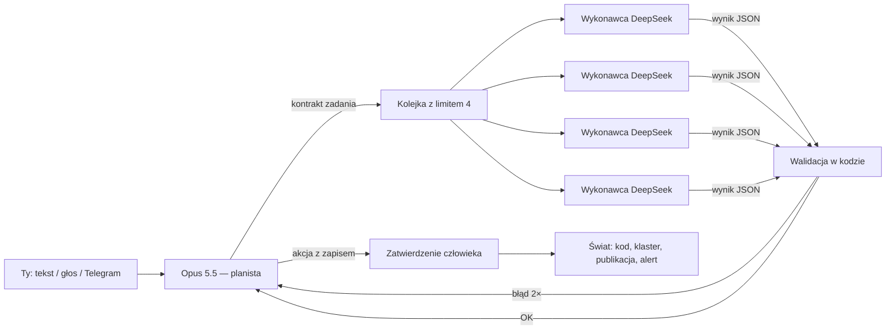

# Architektura: Opus planuje, lokalni agenci wykonują

**Stan na 11 października 2026.** Jak złożyć harnessy z [01-PROFILE.md](01-PROFILE.md) i klocki
z [02-KLOCKI.md](02-KLOCKI.md) w aplikacje na moim sprzęcie: 4× AMD Radeon AI PRO R9700, llama-swap,
DeepSeek-V4-Flash jako lokalny wykonawca, Claude Opus 5.5 jako planista. Liczby sprzętowe są zmierzone
(źródła niżej), ceny chmury sprawdzone na stronie cennika 11.10.2026. Wszystko inne to projekt — **niezmierzony**,
dopóki go nie zbudujesz i nie zmierzysz.

---

## Spis treści

1. [Zasoby: co naprawdę masz](#1-zasoby-co-naprawdę-masz)
2. [Wzorzec: planista i wykonawcy](#2-wzorzec-planista-i-wykonawcy)
3. [Co jest udowodnione, a co nie](#3-co-jest-udowodnione-a-co-nie)
4. [Pięć zastosowań — konkretne układy](#4-pięć-zastosowań--konkretne-układy)
5. [Koszty: czy lokalnie jest taniej?](#5-koszty-czy-lokalnie-jest-taniej)
6. [Ścieżka: co wziąć gotowe, co zbudować samemu](#6-ścieżka-co-wziąć-gotowe-co-zbudować-samemu)

---

## 1. Zasoby: co naprawdę masz

| | DeepSeek-V4-Flash-0731 (UD-IQ3_XXS) | gpt-oss-20b |
|---|---|---|
| Architektura | MoE, 284B parametrów, 13B aktywnych, kontekst do 1M | MoE, MXFP4 |
| Rozmiar wag | 104,2 GB na 4 kartach | ~13 GB |
| Sloty w llama-swap | `--parallel 4`, kontekst 512k = **4 × 131k** | — |
| Generowanie, 1 agent | **22,6 tok/s** | 141 tok/s |
| Generowanie, 4 agentów naraz | **13,6 tok/s na agenta** (54,3 łącznie) | 81 tok/s na agenta (325 łącznie) |
| Czytanie promptu (4 tys. tokenów na agenta) | **1 186 tok/s** dla 1 agenta; **1 694 tok/s łącznie** dla 4 agentów | — |
| Optimum | **3 agentów naraz**: każdy zachowuje 75% prędkości solo, maszyna robi 2,2× więcej pracy | — |
| Jakość — trudny zestaw zadań (PL / EN) | **92 / 93** (agenci 97, research 94, długie dokumenty 86 / 88) | 47 / 52 |

Źródła: [PARALLEL.md](https://github.com/michal-koniu/local-llm-bench-results/blob/main/PARALLEL.md) i
[RESULTS.md](https://github.com/michal-koniu/local-llm-bench-results/blob/main/RESULTS.md)
w repozytorium wyników; model: [karta DeepSeek-V4-Flash](https://huggingface.co/deepseek-ai/DeepSeek-V4-Flash).

Trzy wnioski, które sterują całą architekturą:

1. **VRAM jest pełny.** DeepSeek zostawia na każdej karcie około 1,4 GB. Model mowy, wizji albo generowania obrazów
   nie zmieści się obok — musi działać na CPU, dostać kartę po wymianie modelu w llama-swap (to trwa) albo trafić do
   chmury. To najważniejsze ograniczenie dla U4 i U5.
2. **Kontekst kosztuje czas, nie tylko pamięć — i czytanie jest wspólne.** Jeden agent czyta prompt z prędkością
   około 1 200 tok/s, więc kontekst 50 tys. tokenów bez cache to około 40 sekund, zanim napisze pierwsze słowo.
   Gdy startuje kilku naraz, dzielą tę prędkość między siebie: łącznie rośnie ona tylko do około 1 700 tok/s, więc
   4 agentów, z których każdy zaczyna od 16 tys. tokenów kontekstu, czeka **44 s** na pierwszy token. Dzięki slotom
   każdy agent ma własny prompt cache i w kolejnych turach czyta tylko nową część rozmowy — pod warunkiem stałego
   prefiksu (pułapka H4 w [01-PROFILE.md](01-PROFILE.md#siedem-pułapek-wspólnych-dla-wszystkich)). To ważniejsze
   niż wybór harnessu.
3. **Cztery sloty to twardy limit, trzy — optimum.** Planuj 3 wykonawców naraz i jeden slot w zapasie (na planistę
   w trybie w pełni lokalnym albo na pilne zadanie). Piąte zapytanie czeka w kolejce. Limit ustaw w jednym miejscu
   z kolejką — w bramce (Bifrost), we frameworku (`ConcurrencyLimiter` w Pydantic AI) albo w kolejce zadań
   (DBOS, Prefect).

Masz też w llama-swap wariant `gpt-oss-20b-cpu`, który działa bez kart. Grupa llama-swap, w której modele nie wymieniają
się nawzajem, pozwala trzymać DeepSeeka na GPU i małe modele na CPU jednocześnie — to wejście dla szybkich, prostych
tur (np. głosu). Prędkości generowania wariantu CPU nie mierzyłem.

---

## 2. Wzorzec: planista i wykonawcy



Osiem zasad, zebranych z najlepszych pomysłów harnessów z rankingu:

1. **Kontrakt zadania, nie rozmowa.** Planista wysyła cel, dane wejściowe, dozwolone narzędzia, schemat wyniku, budżet
   (tokeny i czas) i kryterium „gotowe". Wykonawca dostaje świeży kontekst (OpenCode, Deep Agents, Hermes).
2. **Wykonawcy czytają, planista pisze.** Lokalni wykonawcy mają małe zestawy narzędzi tylko do odczytu; wszystko, co
   zmienia świat (zapis plików, `kubectl apply`, publikacja, wydanie pieniędzy) przechodzi przez planistę i człowieka.
3. **Wynik zawsze strukturalny.** JSON walidowany w kodzie + jedna tura naprawy (Hermes `output_schema`, Pydantic AI).
4. **Eskalacja po dwóch porażkach.** Gdy wykonawca dwa razy nie przejdzie walidacji — zadanie wraca do Opusa.
5. **Jeden limit współbieżności** (zasada 3 z sekcji 1).
6. **Stały prefiks promptu** — czas i zmienne dane w wiadomości użytkownika, nie w prompcie systemowym (Moltis).
7. **Myślenie tylko tam, gdzie trzeba.** Dla prostych wykonawców wyłącz tryb myślenia DeepSeeka albo upewnij się,
   że harness odsyła `reasoning_content` (pułapka H2).
8. **Mierz na swoich zadaniach.** Skuteczność i liczba tokenów Opusa na ukończone zadanie, nie na zapytanie.

### Tryb w pełni lokalny

Gdy dane nie mogą wyjść z domu (np. logi służbowe w U1) albo nie chcesz płacić za chmurę, ten sam wzorzec działa bez
Opusa — planistą zostaje DeepSeek. Układ na 4 sloty:

| Slot | Rola | Ustawienia |
|---|---|---|
| 1 | planista: plan, kontrakty zadań, synteza wyników | DeepSeek z włączonym myśleniem, cały kontekst zadania |
| 2–4 | wykonawcy (3 = zmierzone optimum) | DeepSeek, myślenie wyłączone dla prostych zadań, małe zestawy narzędzi tylko do odczytu |
| CPU | szybkie klasyfikacje, routing, krótkie odpowiedzi głosowe | `gpt-oss-20b-cpu` |

Czego brakuje bez Opusa i jak to nadrobić: planista nie jest mądrzejszy od wykonawców, więc **zaostrz kontrakty**
(węższe zadania, jawne kryteria „gotowe", listy kontrolne), **przenieś więcej sprawdzania do kodu** (walidacja,
testy, porównanie z regułami) i **eskaluj do człowieka zamiast do Opusa**. Na trudnym zestawie zadań DeepSeek osiągnął
97 w zadaniach agentowych i 94 w researchu, więc ten tryb jest realny — ale słabiej wypada w długich dokumentach
(86 / 88) i powtarzalności (83), więc tam dodaj powtórne przejście albo człowieka. Każdy harness z rankingu pozwala
ustawić ten sam lokalny model planiście i wykonawcom.

**Lokalny wykonawca jako filtr prywatności.** Wykonawca może streścić logi i usunąć z nich sekrety, zanim cokolwiek
trafi do chmury. Przy danych służbowych to często warunek, by w ogóle użyć planisty w chmurze — zanim wyślesz cokolwiek
do Opusa, sprawdź zasady swojej firmy.

---

## 3. Co jest udowodnione, a co nie

### Udowodnione (zmierzone, z zastrzeżeniami)

| Wynik | Liczby | Źródło |
|---|---|---|
| Silny planista + tani wykonawca działa przy dobrze opisanych podzadaniach | Aider (2024): o1-preview + DeepSeek jako edytor 80,5%, Sonnet + DeepSeek 78,9% | [Aider: architect/editor](https://aider.chat/2024/09/26/architect.html) |
| Chmura dzieli zadanie, lokalny model przerabia długi kontekst | Minions: koszt chmury 5,7× niższy przy 97,9% jakości samej chmury (QA na długich dokumentach) | [arXiv 2502.15964](https://arxiv.org/abs/2502.15964) |
| Eskalacja tylko w punktach decyzji się opłaca | advisor tool Anthropic: Sonnet + doradca Opus +2,7 pp przy 11,9% niższym koszcie (pomiar producenta, tylko modele Claude) | [The advisor strategy](https://claude.com/blog/the-advisor-strategy) |
| Wyuczony routing krok po kroku między urządzeniem a chmurą | Hera: 92,5% skuteczności samej chmury przy użyciu chmury w 46,3% kroków | [arXiv 2605.24598](https://arxiv.org/abs/2605.24598) |
| Same lokalne modele są wyraźnie słabsze | OpenJarvis: zamiana Opus 4.6 na Qwen3.5-9B kosztowała 25–39 pp | [arXiv 2605.17172](https://arxiv.org/abs/2605.17172) |
| Hydraulika działa | llama-server i llama-swap mówią `/v1/messages` (API Anthropic); llama.cpp parsuje wywołania narzędzi DeepSeek (DSML) i od 09.2026 używa prompt cache w pętlach agentów | [llama.cpp #29008](https://github.com/ggml-org/llama.cpp/pull/29008), [llama-swap](https://github.com/mostlygeek/llama-swap) |

### Nieudowodnione albo nieprawdziwe

- **„Subagenci Claude Code / Agent SDK na lokalnych modelach" — to nie jest wspierana funkcja.** Prośba o wybór
  dostawcy per agent ([#38698](https://github.com/anthropics/claude-code/issues/38698)) jest otwarta, a obejścia przez
  bramki rozpoznają model po nazwie albo nagłówkach i wymagają klucza API, nie subskrypcji. **Działa wzorzec odwrotny:**
  Claude zostaje orkiestratorem, a lokalni agenci są dla niego **narzędziami** — serwer MCP
  (np. [mcp-llama-swap](https://github.com/oussama-kh/mcp-llama-swap),
  [PAL](https://github.com/BeehiveInnovations/pal-mcp-server)) albo własne narzędzie w Agent SDK.
- **Advisor tool nie zrobi z DeepSeeka wykonawcy** — wymaga, by i wykonawca, i doradca byli modelami Claude.
  Hybrydę z lokalnym modelem orkiestrujesz sam (albo harnessem z rankingu).
- **Automatyczne przekazywanie lider → pracownik.** Goose miał taki tryb w 2025 i go usunął; przetrwała jawna
  delegacja do nazwanych wykonawców z własnym modelem ([Goose: multi-model](https://goose-docs.ai/docs/guides/multi-model/)).
- **„60–70% wywołań agentów może iść do małych modeli"** — to szacunek z artykułu programowego NVIDII, nie pomiar.
- **„Lokalnie jest taniej"** — patrz [sekcja 5](#5-koszty-czy-lokalnie-jest-taniej).
- **Nie istnieje publiczny pomiar dokładnie Twojej pary** (Opus 5.5 + 3-bitowy DeepSeek-V4-Flash) na zadaniach DevOps,
  okazjach rynkowych czy głosie. Zbuduj własną ewaluację (sekcja 6, etap 0).

---

## 4. Pięć zastosowań — konkretne układy

### U1 — DevOps: rozwój i diagnozowanie

**Nie buduj — weź gotowy harness.** Najprościej: **OpenCode** (albo Goose) z agentem głównym na Opus 5.5 i subagentami
na DeepSeeku. Druga droga, jeśli i tak pracujesz w Claude Code: zostaw Claude Code jako orkiestratora i dodaj mu
serwer MCP, który wysyła zadania do lokalnych agentów (sekcja 3).

```text
alert / zgłoszenie
  → Opus: hipotezy i plan (co sprawdzić)
  → 2–4 lokalnych subagentów RÓWNOLEGLE, tylko do odczytu:
       logi (Loki), metryki (Prometheus), ostatnie wdrożenia (GitHub/GitLab), stan klastra (K8s)
  → każdy zwraca JSON: {fakty, cytaty z logów, pewność}
  → Opus: diagnoza + propozycja poprawki (diff / komenda)
  → Ty zatwierdzasz → zmianę wykonuje Opus albo Ty
```

Klocki: kubernetes-mcp-server (`read_only = true`), mcp-grafana (`--disable-write`), github-mcp-server (`--read-only`),
srt wokół powłoki wykonawców. Uprawnienia w OpenCode: `kubectl get|describe|logs` → allow, `apply|delete|exec` → ask.
Kurs: [część 7 kursu 1](../kurs_lokalne_modele/07-SANDBOX-BEZPIECZENSTWO-MONITORING.md) (piaskownica) i
[część 10 kursu 2](../kurs_aplikacje_agentowe/10-PIASKOWNICA-PRODUKCYJNA.md).

### U2 — Dochód pasywny: złożone przepływy

**Zbuduj własną aplikację na frameworku** — tu zysk jest z dopasowania przepływu do Twojego pomysłu, a gotowe harnessy
są ogólne. Wybór: **Pydantic AI** (typowane wyniki, limit 4 slotów, trwałość przez Prefect / DBOS) albo **LangGraph**
(grafy z checkpointami i przerwaniem dla człowieka). Bez kodu: **n8n** do sklejania integracji (licencja pozwala
na użytek własny, nie na odsprzedaż n8n).

```text
co tydzień:  Opus planuje (co badać, co tworzyć, co mierzyć)
codziennie:  lokalni wykonawcy — research, szkice, ekstrakcja danych, porządki
             → walidacja → Opus ocenia jakość próbek
zawsze:      człowiek zatwierdza wszystko, co publikuje albo wydaje pieniądze (ntfy / Telegram z przyciskiem)
mierz:       przychód, koszt Opusa, czas Twojej uwagi — na jeden ukończony cykl
```

Klocki: Prefect albo DBOS (kolejka z limitem 4), Cognee (pamięć projektów), microsandbox (kod pisany przez agentów),
Apprise → ntfy, promptfoo w CI. Kurs: [część 3 kursu 2](../kurs_aplikacje_agentowe/03-HARNESS-DLUGIE-ZADANIA.md)
(harness długich zadań) i [część 13](../kurs_aplikacje_agentowe/13-FLOTA-WIELU-AGENTOW.md) (flota agentów).

### U3 — Rynki i okazje: wyszukiwanie i alerty

**Lejek: najpierw tanie filtry w kodzie, potem lokalny model, Opus na końcu.** Precyzja bierze się ze struktury
(schematy, deduplikacja, progi w kodzie), a nie z jednego wielkiego promptu.

```text
timery systemd (potem Prefect)
  → źródła: changedetection.io (ceny, dostępność), SearXNG + Crawl4AI / Trafilatura (oferty, newsy),
            OpenBB / edgartools / CCXT tylko do odczytu (rynek)
  → reguły w kodzie: próg ceny, zmiana %, nowość, deduplikacja          ← 90% odpada tu, za darmo
  → lokalny DeepSeek: ekstrakcja do JSON (cena, warunki, ryzyka, źródło) ← równolegle, limit 4
  → reguły w kodzie na JSON-ie
  → Opus tylko dla kandydatów: „czy to naprawdę okazja i dlaczego?"     ← mało tokenów, wysoka jakość
  → alert: ntfy / Telegram z przyciskami, z linkiem do źródła i uzasadnieniem
```

Do precyzyjnej ekstrakcji warto stroić prompt wykonawcy DSPy z Opusem jako nauczycielem. Pamiętaj o warunkach źródeł
danych (Yahoo — użytek osobisty) i o tym, że werdykt agenta to opinia, nie porada inwestycyjna.
Kurs: [część 11 kursu 2](../kurs_aplikacje_agentowe/11-HARMONOGRAM-PROAKTYWNOSC.md) (harmonogram) i
[część 12](../kurs_aplikacje_agentowe/12-KANALY-INTERFEJSY.md) (kanały).

### U4 — rozmowa głosowa po polsku

Lokalnej mowy-do-mowy po polsku na AMD nie znalazłem (październik 2026) — zostaje kaskada STT → LLM → TTS.
Ponieważ VRAM zajmuje DeepSeek, szybkie elementy głosu idą na CPU:

```text
mikrofon → Pipecat + Smart Turn (CPU, rozpoznaje koniec wypowiedzi po polsku)
         → STT: Parakeet-v3 (CPU) albo whisper.cpp large-v3 (GPU, gdy wolna karta)
         → „głos" — szybki model odpowiada od razu i ma narzędzie delegate(zadanie):
              gpt-oss-20b-cpu (lokalnie, prywatnie) albo Haiku 5.5 / Sonnet 5.5 (chmura, szybko)
         → ciężka praca asynchronicznie: DeepSeek (lokalnie) albo Opus (chmura) → wynik wraca do rozmowy
         → TTS: Piper pl_PL (CPU), potem Chatterbox albo VoxCPM2
```

Dlaczego nie DeepSeek bezpośrednio jako „głos": około 20 tokenów do pierwszego zdania przy 13,6–22,6 tok/s to
0,9–1,5 s samego generowania, plus przetwarzanie promptu. Całkowitego opóźnienia tego układu **nie mierzyłem**.

Najprostszy start bez budowania: **Hermes Agent** — notatki głosowe na Telegramie, lokalny faster-whisper z językiem
`pl`, odpowiedzi głosem. Asynchronicznie, ale działa od pierwszego dnia. Uwaga: syntezę mowy robi domyślnie chmurowy
Edge TTS. Jeśli głos ma zostać w domu, wybierz **Moltis** (lokalne STT i Piper z polskimi głosami) albo własny Pipecat.

### U5 — zdjęcia i obrazy

Wzorzec **„mostek wizji"**: tekstowy wykonawca dostaje opis obrazu od modelu wizyjnego (Hermes `vision_analyze`,
ZeroClaw — przekierowanie wizji, Qwen Code `visionModel`, OpenHands MultimodalRouter).

| Zadanie | Gdzie |
|---|---|
| zrzuty ekranu, zdjęcia, wykresy | test DeepSeek-V4-Flash-Vision-Exp (ten sam rozmiar + 0,93 GB); inaczej Qwen3.6-35B-A3B na zwolnionej karcie |
| dokumenty, faktury, PDF | Docling + PaddleOCR-VL-1.5 (mało VRAM, działa też na CPU) |
| generowanie i edycja | stable-diffusion.cpp za llama-swap albo ComfyUI — tylko modele Apache-2.0 przy zastosowaniach zarobkowych |
| trudne przypadki | Opus 5.5 (przyjmuje obrazy) — koszt i prywatność |

Kurs: [część 5 kursu 1](../kurs_lokalne_modele/05-MULTIMODALNOSC.md).

---

## 5. Koszty: czy lokalnie jest taniej?

Ceny API Anthropic (USD za milion tokenów, 11.10.2026, [cennik](https://platform.claude.com/docs/en/about-claude/pricing)):

| Model | Wejście | Odczyt z cache | Wyjście |
|---|---|---|---|
| Claude Opus 5.5 | 4,00 | 0,20 | 20,00 |
| Claude Sonnet 5.5 | 2,00 | 0,10 | 10,00 |
| Claude Haiku 5.5 (prompt ≤ 100 tys. tokenów) | 0,10 | 0,01 | 0,50 |
| Claude Haiku 5.5 (prompt powyżej 100 tys. tokenów — cała tura 5× drożej) | 0,50 | 0,05 | 2,50 |

Batch API: −50% na wejściu i wyjściu (zadania, które mogą poczekać).

**Sufit Twojej maszyny — tylko wyjście:** 54,3 tok/s × 86 400 s ≈ **4,7 mln tokenów wyjścia na dobę** — przy czterech
slotach zajętych bez przerwy przez 24 godziny. Ta sama liczba tokenów wyjścia kosztowałaby w chmurze:

| Model | Koszt 4,7 mln tokenów wyjścia |
|---|---|
| Haiku 5.5 | ok. 2,35 USD |
| Sonnet 5.5 | ok. 47 USD |
| Opus 5.5 | ok. 94 USD |

Prąd policz sam: zmierz pobór z gniazdka przy pełnym obciążeniu i pomnóż przez stawkę. Karty masz ograniczone do 250 W;
przy założeniu 1,2 kW dla całej maszyny i 1 zł za kWh wychodzi około 29 zł na dobę ciągłej pracy (założenie, nie pomiar).

**Ale agent to głównie wejście, nie wyjście.** Realistyczna tura wykonawcy (założenia, nie pomiar): kontekst 30 tys.
tokenów, z czego 28 tys. z cache, 2 tys. nowego wejścia i 500 tokenów wyjścia. Na tej maszynie 4 agentów robi taką turę
w około 42 s (8 tys. nowych tokenów czytanych łącznie z prędkością ~1 700 tok/s to ~5 s, potem 500 tokenów przy
13,6 tok/s to ~37 s), czyli około 8 300 tur na dobę przy pełnym obciążeniu. Te same tury w chmurze
(pomijam niewielki koszt zapisu do cache):

| Model i kontekst | Koszt jednej tury | 8 300 tur na dobę |
|---|---|---|
| Haiku 5.5, kontekst 30 tys. | ~0,0007 USD | ~6 USD |
| Haiku 5.5, kontekst 120 tys. (powyżej progu 100 tys.) | ~0,008 USD | ~68 USD |
| Sonnet 5.5, kontekst 30 tys. | ~0,012 USD | ~98 USD |
| Opus 5.5, kontekst 30 tys. | ~0,024 USD | ~196 USD |

Prąd przy pełnym obciążeniu z przykładu wyżej to ~29 zł na dobę, czyli około 7 USD przy założonym kursie 4 zł za dolara.

**Wniosek:** przy krótkich kontekstach Haiku 5.5 kosztuje **mniej więcej tyle co prąd** tej maszyny przy pełnym
obciążeniu (~6 wobec ~7 USD na dobę) — a gdy maszyna stoi bezczynnie, chmura nie kosztuje nic, prąd tak. Przy
kontekstach powyżej 100 tys. tokenów albo w porównaniu z Sonnetem i Opusem lokalny DeepSeek jest **około 10 do 30 razy
tańszy** — o ile jego jakość wystarcza. Pewne zalety lokalne, niezależne od cen: prywatność
(dane nie wychodzą z domu), brak limitów i kolejek, praca offline i nielimitowane eksperymenty na sprzęcie, który
już masz. Czy Haiku 5.5 dorównuje DeepSeekowi jakością na Twoich zadaniach — **nie wiadomo**: nie był mierzony na
trudnym zestawie z [local-llm-quality-bench](https://github.com/michal-koniu/local-llm-quality-bench).
To dobry następny pomiar.

**W hybrydzie koszt robi planista.** Przykład (założenia, nie pomiar): 30 wywołań Opusa dziennie, każde 20 tys. tokenów
wejścia (z czego 80% z cache) i 2 tys. tokenów wyjścia:

- wejście: 30 × (4 tys. × 4,00 + 16 tys. × 0,20) / 1 mln ≈ 0,58 USD na dobę,
- wyjście: 30 × 2 tys. × 20,00 / 1 mln ≈ 1,20 USD na dobę,
- razem ≈ 1,8 USD na dobę, około 53 USD miesięcznie (pomijam niewielki koszt zapisu do cache).

Dźwignie kosztu, od najtańszej: cache promptu (odczyt 20× tańszy niż wejście), wykonawcy zwracają streszczenia zamiast
surowych logów (mały kontekst planisty), Batch API dla zadań nocnych, niższy `effort` dla rutynowego planowania.

---

## 6. Ścieżka: co wziąć gotowe, co zbudować samemu

| Warstwa | Weź gotowe | Zbuduj sam, jeśli chcesz się nauczyć |
|---|---|---|
| Serwowanie modeli | llama-swap (masz) | — |
| Bramka i limit 4 | Bifrost albo `ConcurrencyLimiter` (Pydantic AI) | semafor w swojej pętli ([kurs 2, część 17](../kurs_aplikacje_agentowe/17-HYBRYDA-I-ROUTER.md)) |
| Agent DevOps | OpenCode albo Goose | — (nie warto) |
| Pętla agenta własnych aplikacji | Pydantic AI albo LangGraph | własna pętla z [kursu 1, części 6](../kurs_lokalne_modele/06-PETLA-AGENTA-OD-ZERA.md) i [kursu 2, części 3](../kurs_aplikacje_agentowe/03-HARNESS-DLUGIE-ZADANIA.md) |
| Harmonogram | timery systemd → Prefect | [kurs 2, część 11](../kurs_aplikacje_agentowe/11-HARMONOGRAM-PROAKTYWNOSC.md) |
| Powiadomienia i kanały | ntfy, Apprise, bot Telegram | [kurs 2, część 12](../kurs_aplikacje_agentowe/12-KANALY-INTERFEJSY.md) |
| Głos | Pipecat | — |
| Pamięć | pliki robocze, potem Cognee | [kurs 2, części 5–6](../kurs_aplikacje_agentowe/05-PAMIEC-DLUGOTERMINOWA.md) |
| Ewaluacja | promptfoo, local-llm-quality-bench | [kurs 2, część 14](../kurs_aplikacje_agentowe/14-EWALUACJA.md) |

Kolejność, w której opłaca się iść:

0. **Ewaluacja przed budową.** 20–50 prawdziwych zadań na zastosowanie, trzy układy: sam Opus, Opus + lokalni,
   sami lokalni. Mierz skuteczność i tokeny Opusa na ukończone zadanie. Bez tego każda decyzja z tej sekcji to zgadywanie.
1. **U1 z OpenCode** — najszybszy zwrot, zero kodu, uczy, jak DeepSeek radzi sobie jako subagent.
2. **Lejek U3** — timery systemd + changedetection.io + SearXNG + ntfy; potem lokalna ekstrakcja i Opus na końcu.
3. **Aplikacja U2** na Pydantic AI albo LangGraph — tu wykorzystasz wszystko z kursu 2.
4. **U4** — najpierw notatki głosowe przez Hermes Agent albo Telegram, potem rozmowa na żywo z Pipecat.
5. **U5** — test Vision-Exp; jeśli zawiedzie, osobny model wizyjny i decyzja o podziale kart.

Bezpieczeństwo całości — [kurs 2, część 16](../kurs_aplikacje_agentowe/16-BEZPIECZENSTWO-OWASP-ASI.md). Zasada nadrzędna:
lokalny wykonawca, który czyta internet, jest celem prompt injection — dlatego czyta, a nie pisze.
